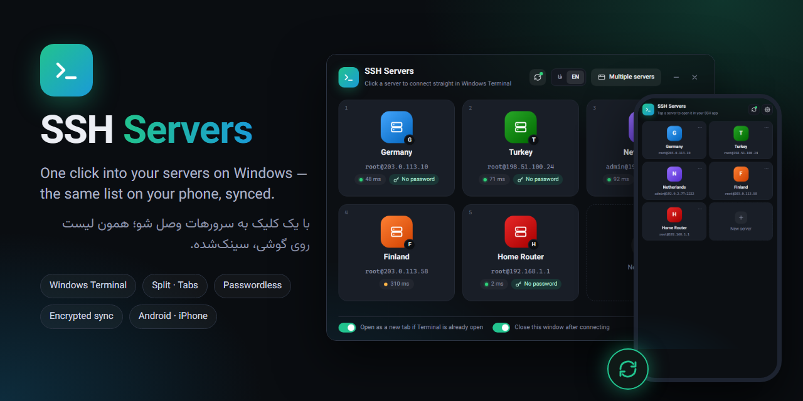
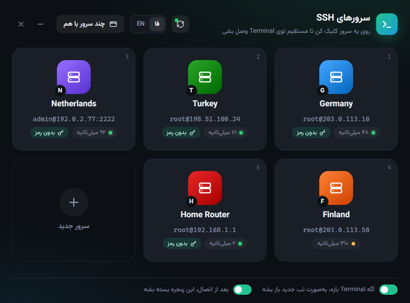
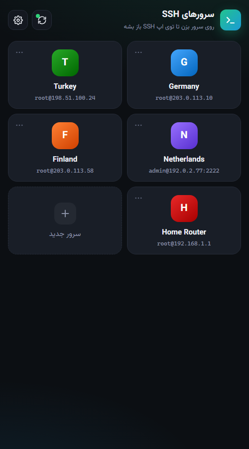

<div align="center" dir="rtl">

# SSH Servers

[English](README.md) · **فارسی**

<a href="https://hits.sh/github.com/Plus98ir/SSH-Servers/"></a> <a href="https://corenetbase.com/#support"></a>

با یک کلیک روی ویندوز به سرورهای SSH خودت وصل شو. همین لیست روی گوشیت هم هست و همیشه سینک می‌مونه.



</div>

<div dir="rtl">

<details>
<summary><b>☕ حمایت · Support</b> — USDT (TRC20) / TRX</summary>
<br>
<p align="center"></p>

```
TA53aFyGNfSAcrCaJi9QmA9x5W47nPJcf7
```

> [!WARNING]
> **فقط شبکه‌ی TRON.** ارسال از ERC20 یا BEP20 پول را از بین می‌برد.

</details>

## دانلود

- **ویندوز:** [`SSH Servers.exe`](https://github.com/Plus98ir/SSH-Servers/releases/latest/download/SSH.Servers.exe). فقط یک فایله و نصب لازم نداره. به WebView2 Runtime نیاز داره که ویندوز ۱۰ و ۱۱ خودشون دارن.
- **گوشی (اندروید / آیفون):** https://corenetbase.com/SSH-Servers/. بازش کن و از منوی مرورگر **Add to Home screen** رو بزن تا مثل یه اپ نصب بشه.

## چه کار می‌کنه

**روی ویندوز**
- هر سرور یه کارته. روش کلیک کن (یا کلیدهای `1` تا `9` رو بزن) تا `ssh` مستقیم توی Windows Terminal باز بشه، توی تب جدید یا پنجره‌ی جدا.
- **چند سرور با هم:** چند سرور رو کنار هم (Split) یا توی تب‌ها باز کن، یا یه دستور رو روی همه‌شون اجرا کن و نتیجه‌ی هر کدوم رو ببین.
- **ورود بدون رمز:** یک بار پسورد رو وارد می‌کنی و برنامه کلید SSH رو روی سرور نصب می‌کنه. پسورد هیچ‌جا ذخیره نمی‌شه.
- **سرور از نو نصب شده؟** اگه host key سرور عوض بشه، برنامه اثر انگشت جدید رو نشون می‌ده و با یک کلیک `known_hosts` رو درست می‌کنه. اگه ورود با کلید هم از کار افتاده باشه، یک بار پسورد می‌پرسه و کلید رو دوباره نصب می‌کنه.
- پینگ زنده روی هر کارت، پشتیبانی از مودم و روترهای قدیمی (`ssh-rsa`)، فارسی و انگلیسی.

**روی گوشی**
- همون کارت‌ها. روی هر سرور بزنی توی اپ SSH گوشیت باز می‌شه ([Termius](https://termius.com)، [ConnectBot](https://connectbot.org) یا هر اپی که لینک `ssh://` رو باز کنه). اگه هیچ اپی لینک رو باز نکرد، دستور `ssh` برات کپی می‌شه.
- می‌تونی سرور اضافه، ویرایش، حذف و جابه‌جا کنی. تغییرات به کامپیوتر هم می‌رسه.
- بدون اینترنت هم با آخرین لیستی که دیده کار می‌کنه.

<p align="center">
&nbsp;

</p>

## سینک

لیست سرورها (اسم، آدرس، پورت، یوزر و رنگ) توی یک **Gist مخفی روی حساب GitHub خودت** ذخیره می‌شه و با AES-256-GCM رمزنگاری شده. هیچ سرور واسطه‌ای از طرف ما وجود نداره و دیتای هر کس روی GitHub خودشه. پسورد و کلید SSH هیچ‌وقت از کامپیوتر بیرون نمی‌ره.

۱. روی کامپیوتر **دکمه‌ی سینک** (بالای برنامه) رو بزن. یک توکن GitHub بساز (فقط تیک `gist` لازمه) و واردش کن.<br>
۲. یه QR کد نشون داده می‌شه. با دوربین گوشی اسکنش کن تا اپ گوشی باز بشه و وصل بشه.<br>
۳. برای اضافه کردن یه کامپیوتر دیگه، به جای توکن همون **لینک سینک** رو توی بخش سینکش بذار.

کامپیوتر نداری؟ توکن GitHub رو روی گوشی وارد کن و از همون‌جا شروع کن. بعداً با لینک سینک می‌تونی کامپیوتر رو هم اضافه کنی.

**همیشه آخرین تغییر برنده‌ست.** هر سرور زمان آخرین ویرایشش رو با خودش داره و هر دستگاه قبل از فرستادن، اول آخرین لیست رو می‌گیره. پس اگه یه دستگاه رو بعد از چند روز باز کنی، اطلاعات قدیمی برنمی‌گرده. سروری هم که روی یه دستگاه حذف بشه، روی همه‌ی دستگاه‌ها حذف می‌مونه.

> [!IMPORTANT]
> لینک سینک توکن و کلید رمزنگاری رو با خودش داره. مثل رمز می‌مونه، به کسی نده.<br>
> توکن فقط دسترسی `gist` لازم داره و هر وقت خواستی می‌تونی از GitHub → Settings → Developer settings باطلش کنی.

## ساختن از سورس

```
go build -trimpath -ldflags "-H windowsgui -s -w" -o "SSH Servers.exe" .
```

Go نسخه‌ی ۱.۲۴ به بالا و ویندوز لازمه. اپ گوشی HTML/JS ساده‌ست که توی پوشه‌ی [`docs/`](docs/) قرار داره و GitHub Pages منتشرش می‌کنه.

لیست سرورها توی فایل `servers.json` کنار exe ذخیره می‌شه.

</div>
