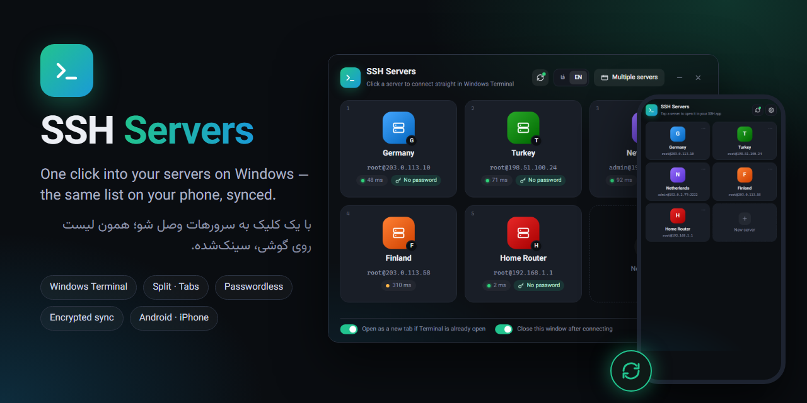
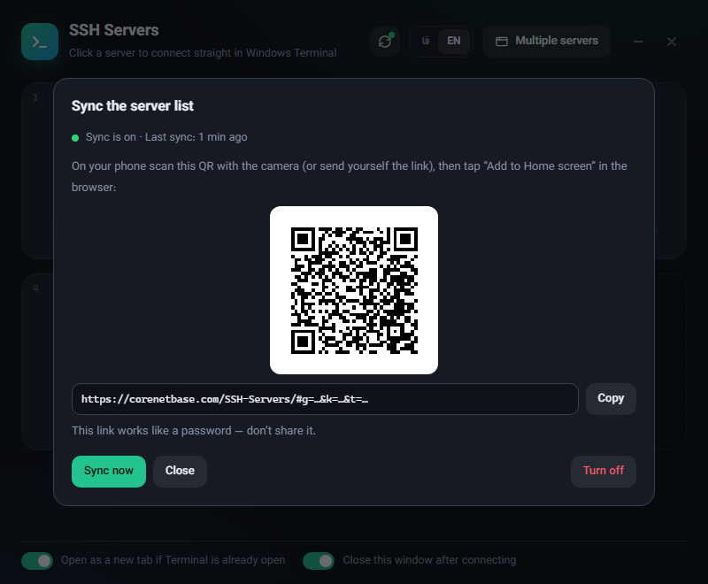
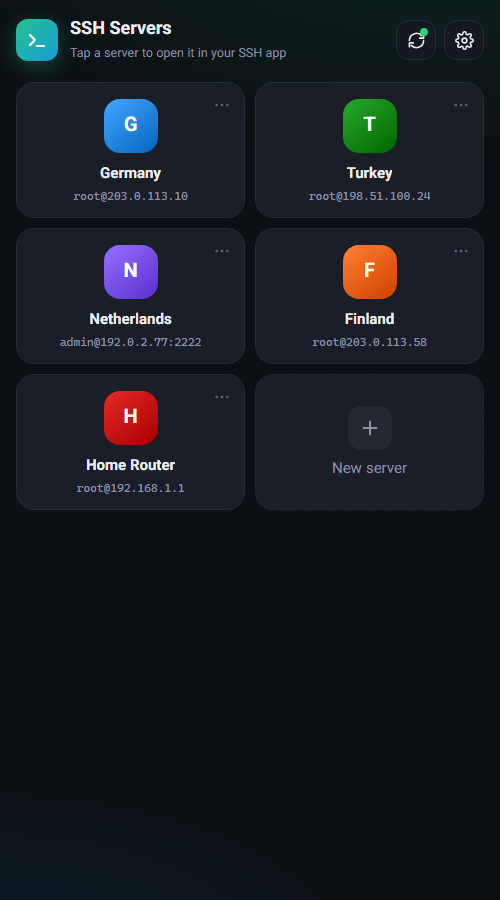

<div align="center">

# SSH Servers

**English** · [فارسی](README.fa.md)

<a href="https://hits.sh/github.com/Plus98ir/SSH-Servers/"></a> <a href="https://corenetbase.com/#support"></a>

One click into your SSH servers on Windows. The same list is on your phone and stays in sync.



</div>

<details>
<summary><b>☕ Support · حمایت</b> — USDT (TRC20) / TRX</summary>
<br>
<p align="center"></p>

```
TA53aFyGNfSAcrCaJi9QmA9x5W47nPJcf7
```

> [!WARNING]
> **TRON network only.** Sending from ERC20 / BEP20 will lose the funds.<br>
> **فقط شبکه‌ی TRON.** ارسال از ERC20 یا BEP20 پول را از بین می‌برد.

</details>

## Download

- **Windows:** [`SSH Servers.exe`](https://github.com/Plus98ir/SSH-Servers/releases/latest/download/SSH.Servers.exe). It's one file with nothing to install. It needs the WebView2 Runtime, which Windows 10/11 already has.
- **Android:** [`SSH-Servers.apk`](https://github.com/Plus98ir/SSH-Servers/releases/download/android-v1.0.0/SSH-Servers.apk). A real SSH client with a built-in terminal, synced with the Windows app.
- **Website:** https://corenetbase.com/SSH-Servers/
- **Web version (any phone):** https://corenetbase.com/SSH-Servers/app/. Open it and use **Add to Home screen** to install it like an app.

## What it does

**On Windows**
- Each server is a card. Click one (or press `1`–`9`) and `ssh` opens straight in Windows Terminal, in a new tab or its own window.
- **Multiple servers:** open several servers side by side (split panes) or in tabs, or run one command on all of them and see each result.
- **Files (SFTP):** a built-in file manager for every server. Browse folders, upload by dragging files or folders from Explorer, download to your Downloads folder, rename, delete, change permissions, and edit config files right in the app. Transfers show progress and can be cancelled.
- **Passwordless login:** enter the password once and the app puts your SSH key on the server. The password is never saved.
- **Rebuilt server?** When a server's host key changes, the app shows the new fingerprint and fixes `known_hosts` in one click. If the key login broke too, it asks for the password once and reinstalls the key.
- Live ping on every card, old routers and modems (`ssh-rsa`) supported, FA / EN.

**On the phone**
- The same cards. Tap one and it opens in your SSH app ([Termius](https://termius.com), [ConnectBot](https://connectbot.org) or any app that handles `ssh://` links). If no app picks the link up, the `ssh` command is copied for you.
- You can add, edit, delete and reorder servers. Changes reach your PC too.
- Works offline with the last list it saw.

<p align="center">
&nbsp;

</p>

## Sync

The server list (name, address, port, user and color) is stored in a **secret Gist on your own GitHub account**, encrypted with AES-256-GCM. There's no server of ours in between, and every user keeps their own data on their own GitHub. Passwords and SSH keys never leave the PC.

1. On the PC press the **sync button** (top bar), then **Sign in with GitHub**. GitHub opens in the browser: enter the short code shown in the app and press Authorize. That's it, no token to create. A personal token with the `gist` scope still works too.
2. A QR code appears. Scan it with your phone camera. The phone app opens and is connected.
3. To add another PC, paste the same **sync link** into its sync box instead of a token.

No PC? Paste a GitHub token on the phone and start there. You can add the PC later with the sync link.

**The newest change always wins.** Every server carries the time of its last edit, and every device fetches the latest list before sending its own. A device you open after a few days never brings old entries back, and a server deleted on one device stays deleted everywhere.

> [!IMPORTANT]
> The sync link holds your token and the encryption key. It works like a password, so don't share it.<br>
> The app only asks for the `gist` scope. You can revoke access any time in GitHub → Settings → Applications.

## Build

```
go build -trimpath -ldflags "-H windowsgui -s -w" -o "SSH Servers.exe" .
```

Go 1.24+ and Windows (WebView2 via [go-webview2](https://github.com/jchv/go-webview2)). The website ([`docs/`](docs/)) and the phone app ([`docs/app/`](docs/app/)) are static HTML/JS served by GitHub Pages.

The server list lives in `servers.json` next to the exe.
